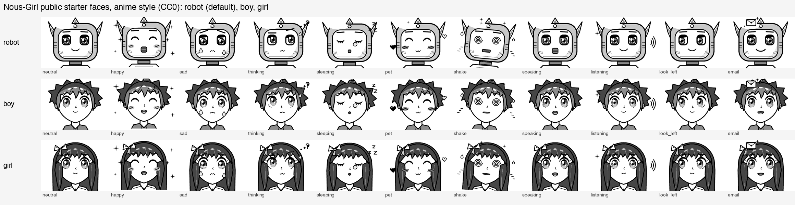
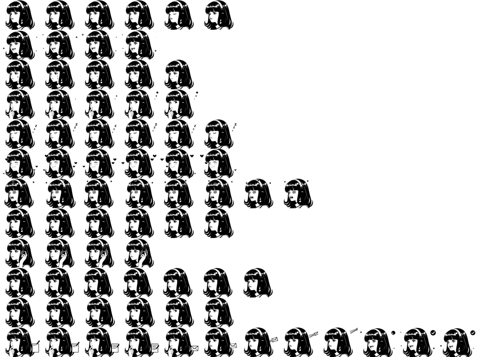

# Nous-Girl

**A self-hosted [StackChan](https://github.com/m5stack/StackChan) robot with a face you choose, a real memory, and a DJ habit.**

> **Status:** a hobby project with one maintainer, built with heavy AI assistance. It runs end to end on the maintainer's own robot and computer, but nobody has tried it on anyone else's hardware yet. Public firmware comes with checksums and rollback steps, original starter faces and **no server built in**: you run your own. Server and brain add-ons are in [server/](./server/README.md).
>
> **Beta:** builds verified by scan and checksum, not yet tested on hardware. Stuck or found a bug? See [Where to get help](#where-to-get-help).

> **Current firmware: `v3.6.7-dj7`** (Oct 28, 2026), with a robot, boy or girl face. Public checkpoints: v3.6, v3.6.6, v3.6.7-dj5, v3.6.7-dj7. Full history, checksums and rollbacks: [VERSIONS.md](./VERSIONS.md).

Nous-Girl runs custom firmware on the M5Stack StackChan K151 (CoreS3). The [xiaozhi-esp32-server](https://github.com/xinnan-tech/xiaozhi-esp32-server) voice server runs in Docker on your computer and handles listening and speaking with local models. Her brain is [Hermes Agent](https://hermes-agent.nousresearch.com/) from Nous Research, which gives her long-term memory and tools, or a plain local model through [Ollama](https://ollama.com/) if you want to keep it simple.

## Where to get help

New to this? No question is too basic. Pick the one that fits:

| You want to... | Go here |
|---|---|
| Ask a question or get help setting up | [Discussions: Q&A](https://github.com/dax8it/nous-girl-stackchan/discussions/categories/q-a) |
| Report something that's broken | [Issues](https://github.com/dax8it/nous-girl-stackchan/issues/new/choose) (a short form walks you through it) |
| Suggest an idea or a new feature | [Discussions: Ideas](https://github.com/dax8it/nous-girl-stackchan/discussions/categories/ideas) |
| Show off your robot or your own face | [Discussions: Show and tell](https://github.com/dax8it/nous-girl-stackchan/discussions/categories/show-and-tell) |
| Report a security problem | privately, see [SECURITY.md](./SECURITY.md) (please not in public) |
| Just say hi or ask something quick | X DMs to [@alexcovo_eth](https://x.com/alexcovo_eth) |

This is a hobby project with one maintainer, so replies are best effort and may take a few days. Before posting logs or photos, remove Wi-Fi names and passwords, server addresses, tokens and email addresses.

## Pick a brain

> **If you want your robot to remember you, you need Hermes Agent.** Without Hermes she still talks, but starts fresh every conversation.

| Setup | What it is | Memory | Tools (web, email, memes, skills) | Robot tools (face, look, dance, photo) | Fully local? | Difficulty |
|---|---|---|---|---|---|---|
| **A. Hermes + any model** | Voice server sends her words to Hermes; Hermes uses any model, cloud or local | **Yes, long-term** | Yes | Yes, through the stackchan MCP server | Depends on the model | Hardest |
| **B. Hermes + Ollama** | Same as A, with the model running in Ollama on your computer | **Yes, long-term** | Yes (internet tools still need internet) | Yes | **Yes** | Medium |
| **C. Ollama only** | Voice server talks straight to Ollama | No, fresh every time | No | Yes, if the model can call tools | **Yes** | Easiest |

Hermes setup, her profile and how to write her personality file (`SOUL.md`): [docs/HERMES.md](./docs/HERMES.md).

## Features

Every feature, with how to turn it on, what to say, how to set it up on your own server and how to undo it: [docs/FEATURES.md](./docs/FEATURES.md). Every Settings screen option, explained: [docs/SETTINGS.md](./docs/SETTINGS.md). Windows, Linux and macOS: [docs/PLATFORMS.md](./docs/PLATFORMS.md).

- **Faces and lip sync:** animated faces that follow her state, vowel-shaped mouth, moods from happy to scowl. Three CC0 starter faces, or [make your own](./docs/SPRITES.md). Every face and what triggers it: [docs/EMOTES.md](./docs/EMOTES.md).
- **Wake words:** "Hey Nous-Girl" and "Hey Jarvis". Tap the screen to stop her.
- **Lights, dance and head touch:** 12 RGB LEDs, preset and recorded dances, a 3-pad head sensor.
- **Music, DJ mode and radio:** songs from your computer or an SD card, set lists, a live 13-band equalizer, beat-synced colors, internet radio, and a rave mode for grown-ups.
- **Multilingual voice:** English, Spanish, French, German and Portuguese, each with its own voice.
- **Camera:** "what do you see", face ID, and follow faces with on-robot face detection.
- **Actor Mode:** she performs scripts with timed face, light and dance cues. Write your own: [docs/ACTOR-MODE.md](./docs/ACTOR-MODE.md).
- **Fun pack:** trivia, spelling bee, memory games and story time, with kid-safe memory.
- **Email:** her own AgentMail inbox. She reads back and waits for a yes before sending.
- **Local memes:** classic memes made on your computer, shown on her screen, and emailed only to approved addresses after a read-back.
- **Crash report:** Settings > About shows why she last restarted.

## First boot

Public firmware has no server built in, so a new robot connects nowhere until you set one. Full steps and troubleshooting: [docs/SELF-HOSTING.md](./docs/SELF-HOSTING.md#first-boot-step-by-step).

1. **Find your server address.** Own server: `http://<your-computer-ip>:8003/xiaozhi/ota/` (Mac: `ipconfig getifaddr en0`; Windows: `ipconfig`; Linux: `hostname -I`). Or the official xiaozhi cloud: `https://api.tenclass.net/xiaozhi/ota/`.
2. **Join her setup Wi-Fi.** Turn her on, join the `Xiaozhi-XXXX` network from your phone, open `http://192.168.4.1` if the page doesn't pop up, and pick your home Wi-Fi (2.4 GHz) and password.
3. **Set the server.** Hold the screen 1.5 s > **Server**, type your address, tap **Save + restart**.
4. **Check it worked.** She plays a "ready" sound with no error, Settings > Server shows your address, and "Hey Nous-Girl" gets an answer.

## What runs where

| Component | Host | Notes |
|---|---|---|
| StackChan K151 (robot) | ESP32-S3 on your desk | Nous-Girl firmware, see [VERSIONS.md](./VERSIONS.md) |
| xiaozhi-esp32-server | your computer, Docker | voice in/out, OTA, robot bridge. Your own server: [docs/SELF-HOSTING.md](./docs/SELF-HOSTING.md) |
| Speech-to-text | your computer | Parakeet (MLX) on a Mac |
| Text-to-speech | your computer | Phonon voice servers |
| Hermes Agent (optional) | your computer | profile `nous-girl`, API server on localhost |
| Model | cloud or Ollama | your choice |

Windows, Linux, macOS, a home server or the cloud: [docs/PLATFORMS.md](./docs/PLATFORMS.md). Only macOS (Apple Silicon) is tested so far.

## Get it running

1. **Back up your robot,** then flash the current firmware (pick robot, boy or girl). Exact commands, including moving from stock firmware: [VERSIONS.md](./VERSIONS.md#how-to-flash).
2. **Start your own voice server** ([xiaozhi-esp32-server](https://github.com/xinnan-tech/xiaozhi-esp32-server)) in Docker on your computer, home-only or with your own domain: [docs/SELF-HOSTING.md](./docs/SELF-HOSTING.md). Download the models below.
3. **Connect the robot:** follow [First boot](#first-boot).
4. **Optional:** set up Hermes as her brain: [docs/HERMES.md](./docs/HERMES.md).
5. **Say "Hey Nous-Girl".**

Our patched server and the add-ons (DJ mode, radio, Actor Mode, multilingual voice, robot tools for Hermes, memes, email, fun pack) are in [server/](./server/README.md), each with install, check and undo steps. Away from home Wi-Fi? Use your phone as a hotspot: [docs/HOTSPOT.md](./docs/HOTSPOT.md).

## Models

No model files are in this repo. Download them from the links.

| Model | Used for | Size | License |
|---|---|---|---|
| [gradium/phonon-40m-multilingual](https://huggingface.co/gradium/phonon-40m-multilingual) | her voice in en/es/fr/de/pt | 72 MB | **CC-BY-NC-4.0, gated** (accept terms, non-commercial) |
| [gradium/phonon-31m-en](https://huggingface.co/gradium/phonon-31m-en) | English fallback voice | 160 MB | Apache-2.0 |
| [gradium/phonon-voices](https://huggingface.co/gradium/phonon-voices) | voice files (Harper, Zoey and others) | about 256 KB each | Apache-2.0 |
| [ptts-openai-server](https://github.com/gradium-ai/xn-ptts) | serves Phonon as an OpenAI-style TTS endpoint | 24 MB binary | Apache-2.0 / MIT |
| [mlx-community/parakeet-tdt-0.6b-v3](https://huggingface.co/mlx-community/parakeet-tdt-0.6b-v3) | speech-to-text | 2.3 GB | CC-BY-4.0 (credit NVIDIA) |
| [mlx-community/whisper-large-v3-turbo-asr-fp16](https://huggingface.co/mlx-community/whisper-large-v3-turbo-asr-fp16) | backup speech-to-text | 1.5 GB | MIT |
| [Ollama gemma4:e4b](https://ollama.com/library/gemma4) | vision ("what do you see"), brain in setup C | 9.6 GB | Apache-2.0 |
| [Silero VAD](https://github.com/snakers4/silero-vad) | detects when someone is speaking | 6.9 MB | MIT, ships with the server |
| [esp-dl face detect](https://github.com/espressif/esp-dl) | follow faces, on the robot | in firmware | MIT |

## Gallery: bring your own face

Public builds ship three original starter faces, drawn by a script and released as CC0. **Robot** is the default; **boy** and **girl** are separate downloads.

Every frame of each face: [robot](./faces/starter/robot/preview.png), [boy](./faces/starter/boy/preview.png), [girl](./faces/starter/girl/preview.png).

You can add your own art to your robot: the exact format, AI image prompts and conversion steps are in [docs/SPRITES.md](./docs/SPRITES.md). Only publish art you made or have the right to share.

## Tribute: Nous-Girl

The maintainer's own robot wears a fan-made tribute to **Nous Research's Nous-Girl** character. The files are in [faces/tribute/nous-girl/](./faces/tribute/nous-girl/README.md) so you can put her on your own StackChan.

This is fan art, not affiliated with or endorsed by Nous Research. The character and her likeness belong to their owners. These files are **not** under the repo's MIT license: personal, non-commercial use only, and they will be removed if the rights holder asks. Public builds still ship the robot starter face.

## Coming soon (not released yet)

These are planned or staged on the maintainer's machine. None of them are in a release.

- **Lite mode with Liquid AI LFM3.** A second Hermes profile running Liquid AI's small [LFM3-1.7B](https://huggingface.co/LiquidAI/LFM3-1.7B-GGUF) model locally through llama.cpp (about 1 GB at 4-bit, built for agent tool calling, 16 languages). She keeps her personality, robot tools and memory, but no email or computer tools. A small router lets you switch brains by voice: "lite mode" and "full mode". Next tests: speed and tool-calling quality, then an end-to-end audio model from [Liquid AI](https://www.liquid.ai/models) such as [LFM2.5-Audio](https://huggingface.co/LiquidAI/LFM2.5-Audio-1.5B).
- **Nous-hosted version.** Running her agent and its model entirely in Nous Research's cloud with [Hermes Cloud](https://portal.nousresearch.com/cloud) (always-on hosted Hermes Agent, billed through [Nous Portal](https://portal.nousresearch.com/)), so only the voice server runs at home. Not tested yet.
- **Fully local brain with Ollama.** Testing setups B and C with [Ollama](https://ollama.com/) models and documenting which ones handle her robot tools well.
- **More languages.** Testing voices and models for Chinese, Japanese, Dutch and others. Phonon multilingual already covers English, Spanish, French, German and Portuguese.
- **Classifier for learning.** One approve / reject / log step for what she learns: memories, object names and scene descriptions. Simple rules run first, and an optional local classifier model ([Cloudflare clef-flash](https://huggingface.co/Cloudflare/clef-flash), about 19 GB) can review the rest. Anything unclear waits for a grown-up to approve.
- **Memory with Hermes Agent.** Documenting how her long-term memory works with [Hermes memory](https://hermes-agent.nousresearch.com/docs/user-guide/features/memory): what she keeps, how to view and clear it, and kid-safe rules.
- **A beginner setup script** for the voice server and add-ons. The add-ons themselves are already in [server/](./server/README.md).

## AI transparency

This project is built with a lot of help from AI coding agents: firmware patches, server packs, tests and these docs. A human reviews, flashes and tests everything on the real robot before it is called working.

## Support

Questions: [Discussions Q&A](https://github.com/dax8it/nous-girl-stackchan/discussions/categories/q-a). "This didn't work for me": [open an issue](https://github.com/dax8it/nous-girl-stackchan/issues/new/choose). All the options: [Where to get help](#where-to-get-help). Want to help? See [CONTRIBUTING.md](./CONTRIBUTING.md). Security problems: report privately, see [SECURITY.md](./SECURITY.md).

## Deeper reference

- [VERSIONS.md](./VERSIONS.md): every firmware version, checksums, flashing and rollback.
- [docs/FEATURES.md](./docs/FEATURES.md): every feature: turn it on, use it, set it up yourself.
- [docs/SETTINGS.md](./docs/SETTINGS.md): every Settings screen option, gesture and default.
- [docs/PLATFORMS.md](./docs/PLATFORMS.md): what runs on Windows, Linux and macOS.
- [docs/HERMES.md](./docs/HERMES.md): Hermes Agent setup, her profile, writing SOUL.md.
- [docs/SELF-HOSTING.md](./docs/SELF-HOSTING.md): run your own voice server, home-only or with your own domain.
- [server/README.md](./server/README.md): the patched voice server and every add-on, with the installer.
- [docs/HOTSPOT.md](./docs/HOTSPOT.md): run her from an iPhone or Android hotspot.
- [docs/EMOTES.md](./docs/EMOTES.md): every face, alias and what triggers it, and how to add one.
- [docs/ACTOR-MODE.md](./docs/ACTOR-MODE.md): Actor Mode scripts, the full format and a first-script walkthrough.
- [docs/SPRITES.md](./docs/SPRITES.md): make your own face, with AI image prompts.
- [faces/starter/](./faces/starter/): the CC0 starter faces and the script that draws them.
- [faces/tribute/nous-girl/](./faces/tribute/nous-girl/README.md): the Nous-Girl tribute face (fan art, not MIT).
- [THIRD_PARTY_NOTICES.md](./THIRD_PARTY_NOTICES.md): every third-party part of the firmware and its license.
- [docs/RELEASING.md](./docs/RELEASING.md): release tags and assets.
- [docs/TOOLCHAIN-VERSIONS.md](./docs/TOOLCHAIN-VERSIONS.md): the exact ESP-IDF toolchain.
- [sprite-scripts/](./sprite-scripts/): scripts that turn key pictures into face animations.

## Credits

Created by **Alex Covo**. X: [@alexcovo_eth](https://x.com/alexcovo_eth). Built on the open source projects listed in [THIRD_PARTY_NOTICES.md](./THIRD_PARTY_NOTICES.md).

## License

- Code and docs: [MIT](./LICENSE), copyright 2026 Alex Covo (dax8it).
- Starter faces in `faces/starter/`: [CC0](./faces/starter/LICENSE) (public domain).
- Tribute art in `faces/tribute/`: **excluded** from the MIT license, see [its README](./faces/tribute/nous-girl/README.md).
- Firmware builds also contain third-party software (xiaozhi-esp32, ESP-IDF, LVGL, esp-sr, M5Stack and more), each under its own license: see [THIRD_PARTY_NOTICES.md](./THIRD_PARTY_NOTICES.md) and the full texts in [licenses/](./licenses/).
- Models and the voice server are downloaded separately under their own terms (see [Models](#models)).

## References

- StackChan: https://github.com/m5stack/StackChan
- xiaozhi-esp32 firmware (upstream): https://github.com/78/xiaozhi-esp32
- xiaozhi-esp32-server: https://github.com/xinnan-tech/xiaozhi-esp32-server
- Hermes Agent: https://hermes-agent.nousresearch.com/ ([GitHub](https://github.com/NousResearch/hermes-agent))
- esptool: https://github.com/espressif/esptool
- Layout inspired by [Dotty](https://github.com/BrettKinny/dotty-stackchan), another self-hosted StackChan.
