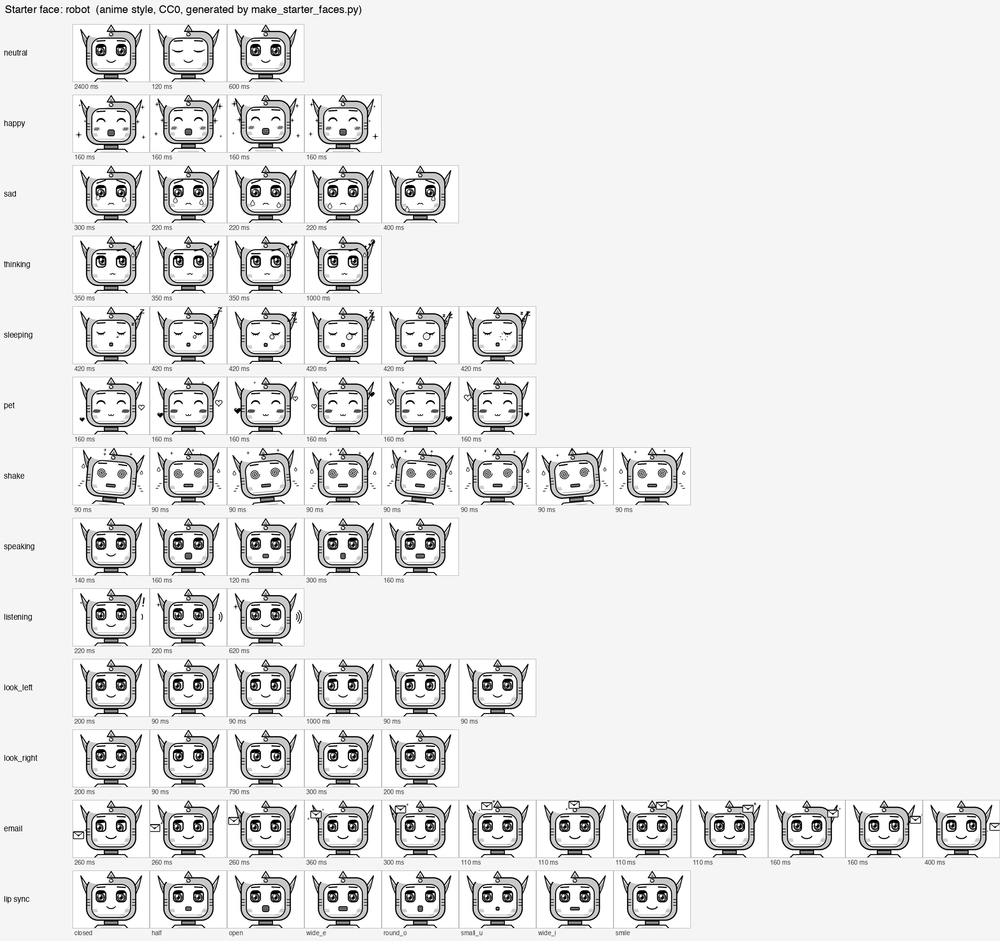
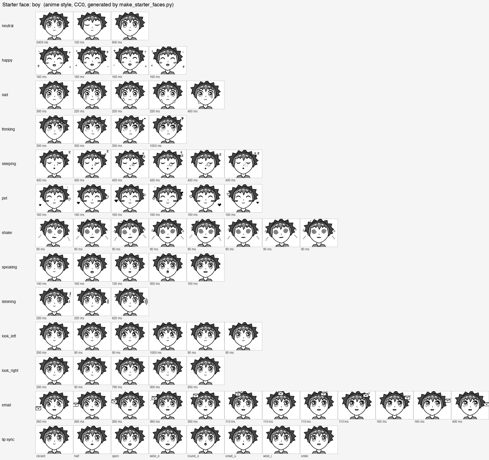
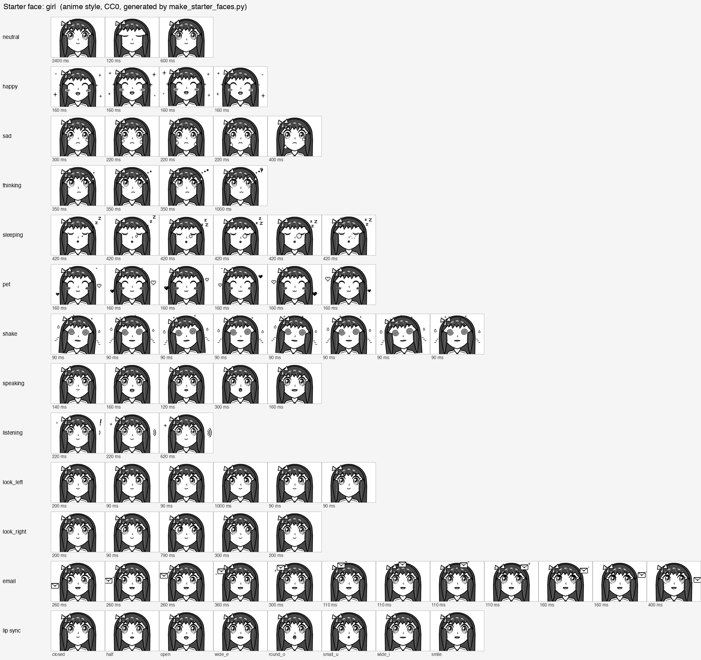

# Starter faces (CC0)

Three original anime / manga style faces drawn by `make_starter_faces.py`: **robot** (default in public builds, a cute anime mecha), **boy**, **girl**. Each has all 12 animations, the blink, and 8 lip-sync mouths for the neutral, sad, thinking and pet moods.

Style: black ink on white with 6 greys (0, 70, 140, 200, 235, 255) used as cel shading, big eyes with two highlights, hair shine, hatched blush, and manga symbols (sparkles, sweat drops, tears, hearts, nose bubble, spiral eyes). The angry scowl and anger mark are drawn by the firmware at the spots in `hg_face_layout.h`.

| Face | Preview |
|---|---|
| robot |  |
| boy |  |
| girl |  |

Rebuild everything (needs Python 3 and Pillow):

```
python3 make_starter_faces.py .
```

Each folder holds `gifs/` (copy into the firmware's `fairy-assets/`), `hg_mouth_frames.h` and `hg_face_layout.h` (copy into `main/boards/m5stack/core-s3/`), `sheet.png` (every frame, one row per animation, last row the lip-sync mouths) and `preview.png`.

Want to change a face? Every part is a small function in the script (`body_boy`, `body_girl`, `body_robot`, `eyes`, `mouth`, and the symbol helpers such as `sparkle`, `drop`, `heart`). Keep the eye centres, `MOUTH_BOX` and the canvas size the same and the firmware will line up.

Make your own: see [docs/SPRITES.md](../../docs/SPRITES.md). License: [CC0](LICENSE).
